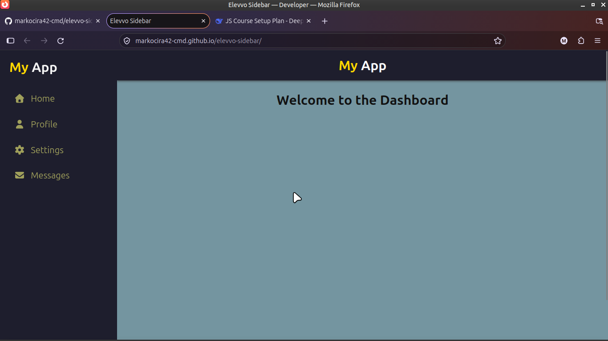
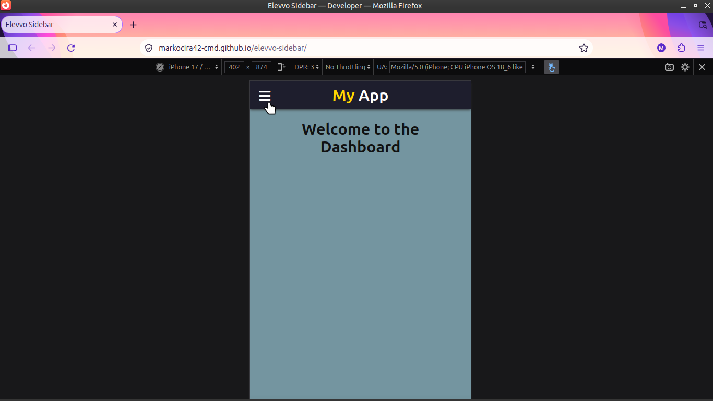
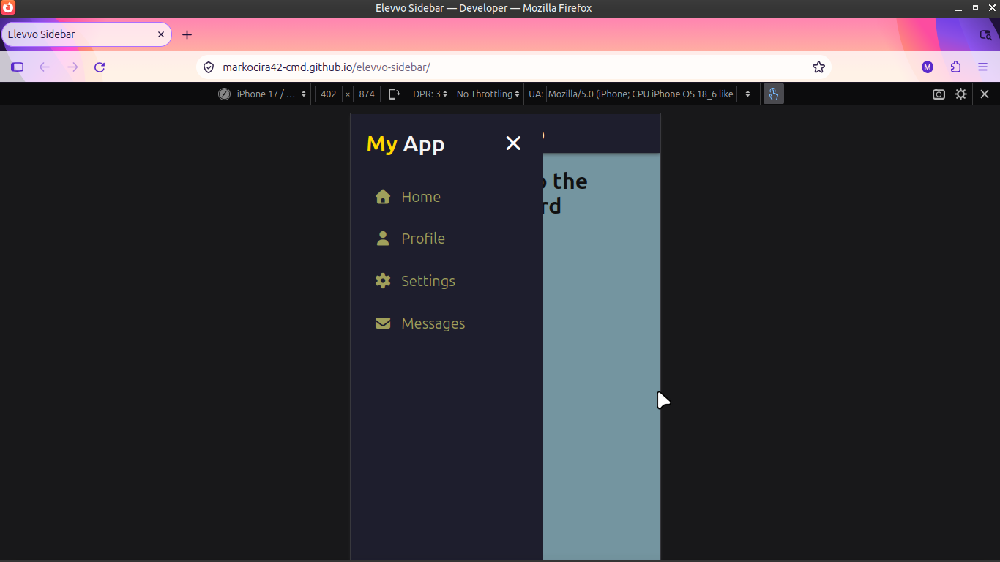

# Elevvo Task 1: Collapsible Sidebar

A fully responsive, mobile-first collapsible sidebar built from scratch using HTML, CSS, and Vanilla JavaScript.

## Features
- Smooth CSS transition animations (`transform: translateX`).
- **Click-outside-to-close** logic using DOM event delegation.
- Unique hamburger menu (open) and X mark (close) buttons.
- Fully responsive: stays open on desktop, hides on mobile.

## Built With
- HTML5
- CSS3 (Flexbox, Media Queries)
- Vanilla JavaScript (DOM Manipulation, Event Listeners)

## Live Demo
https://markocira42-cmd.github.io/elevvo-sidebar/

## Screenshots

### Desktop View

### Mobile View (Closed)

### Mobile View (Open)

